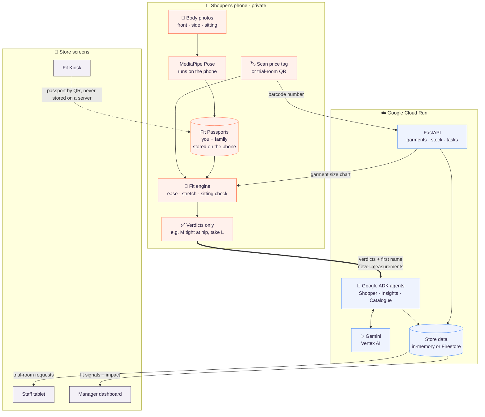
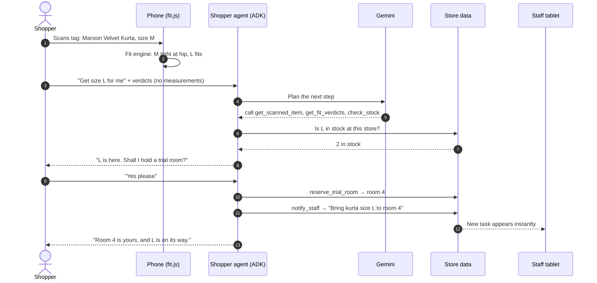

<div align="center">


# snug

### The right size, first try.

**Scan your body once. Scan any price tag. Know your size, and let an AI agent fetch it.**

[](https://snug-5zcsxlm5za-el.a.run.app/)
[](https://snug-5zcsxlm5za-el.a.run.app/app/)


*Team Snug · Hackathon 2026*

</div>

---

## The idea in one line

> **Math decides your size. AI measures you on the phone and acts for you in the store.**

Shoppers carry two or three sizes into the trial room because every brand sizes differently. Snug replaces the guessing with a **Fit Passport** that lives only on your phone:

| | Step | Where it happens |
|:-:|---|---|
| 📸 | **1. Scan your body once.** Front, side and sitting photos become measurements. Photos are wiped instantly. | Your phone |
| 🏷️ | **2. Scan the barcode on any price tag.** Snug fetches that garment's size chart. | Phone + Cloud Run |
| ✅ | **3. Get an instant verdict.** *"Size M will be about 2.0 in tight at the hip. Grab size L instead."* Standing **and** sitting. | Your phone |
| 🤖 | **4. The agent acts.** It checks stock, holds a trial room, messages staff, and suggests what goes with it. | Gemini on Cloud Run |

---

## Architecture

The design has one rule: **body measurements never cross the privacy line.** The phone does the private work; the cloud only ever sees fit verdicts like *"L fits"*.



### What happens when you tap "Get size L for me"



---

## Tech stack

<table>
<tr><th>Layer</th><th>Technology</th><th>Language</th><th>Why</th></tr>
<tr><td>🧍 Body measurement</td><td>Google MediaPipe Pose Landmarker (tasks-vision) with segmentation masks</td><td>JavaScript</td><td>Runs on the phone's GPU; photos never leave the device</td></tr>
<tr><td>📐 Fit engine</td><td><code>fit.js</code> on the phone, twin <code>fit_engine.py</code> on the server</td><td>JS + Python</td><td>Deterministic rules and math decide the size, not an LLM; both copies are tested to agree</td></tr>
<tr><td>📷 Scanning</td><td>html5-qrcode (EAN-13, UPC, QR), JsBarcode, qrcode-generator</td><td>JavaScript</td><td>Price-tag barcodes and trial-room QR codes, bundled locally</td></tr>
<tr><td>📱 Shopper app</td><td>Plain HTML, CSS and JavaScript as an installable PWA</td><td>JavaScript</td><td>No framework, fast on any phone, works from a link</td></tr>
<tr><td>🔐 Accounts</td><td>Firebase Authentication: phone OTP and email/password, plus guest mode</td><td>JavaScript</td><td>Stores only name and phone/email, never measurements</td></tr>
<tr><td>🤖 Agents</td><td>Google Agent Development Kit (ADK): 3 agents with function-calling tools</td><td>Python</td><td>Multi-step planning and real actions: stock, holds, staff tasks</td></tr>
<tr><td>✨ Model</td><td>Gemini Flash on Vertex AI, with retries and a fallback model</td><td>n/a</td><td>Fast tool use; replies in English and 6 Indian languages</td></tr>
<tr><td>🌐 API server</td><td>FastAPI + Uvicorn, one service for agents, API and web app</td><td>Python</td><td>One deploy, one URL</td></tr>
<tr><td>🗄️ Data</td><td>In-memory store (default) or Cloud Firestore</td><td>Python</td><td>Clean demo state on restart; Firestore for persistence</td></tr>
<tr><td>☁️ Hosting</td><td>Cloud Run (always one warm instance), Cloud Build, Artifact Registry</td><td>n/a</td><td>HTTPS for camera access, no cold starts during evaluation</td></tr>
</table>

---

## The three agents

| Agent | Who uses it | Tools | What it does |
|---|---|---|---|
| 🛍️ **Shopper agent** `snug_agent` | Shoppers, in the app | `get_scanned_item` `search_catalogue` `get_garment_details` `get_fit_verdicts` `check_stock` `suggest_pairings` `reserve_trial_room` `notify_staff` `record_feedback` | Gets the right size in stock, holds a trial room, messages staff, finds alternatives, completes the look, recovers when something doesn't fit |
| 📊 **Insights agent** `insights_agent` | Store managers | `get_fit_signals` `get_impact` `get_stock` | Answers *"Which styles run small?"* from anonymous try-on feedback and shows wrong-size try-ons avoided |
| 📄 **Catalogue agent** `catalogue_agent` | Brands and buyers | `save_size_chart` | Reads a size-chart photo or PDF with Gemini; a validator catches errors and sends them to human review |

---

## Privacy by design

| Data | Stays on the phone | Sent to the cloud |
|---|:-:|:-:|
| Body photos | Wiped right after measuring | ❌ never |
| Body measurements | ✅ | ❌ never |
| Fit verdicts (*"L fits"*) | ✅ | ✅ to the agent |
| Profile first name | ✅ | ✅ so the agent can say *"For Mom, L fits"* |
| Your location (nearest store) | ✅ | ❌ never |
| Scan events | n/a | ✅ anonymous: style, sizes, verdict |
| Kiosk passport | ✅ arrives in the QR's URL `#fragment` | ❌ never |

---

## Features

<details open>
<summary><b>For shoppers</b></summary>

- **3-photo body scan** with a live camera guide and 5-second timer, or upload photos
- **🪑 Sitting check** for jeans, trousers, shirts, blazers, kurtas and dresses: catches sizes that dig in, pull at the buttons or ride up when you sit
- **No-photo options:** *"Tell Snug what you wear"* estimates from sizes you own, or type measurements in; plus a tape-measure accuracy check
- **Several people on one phone:** passports for you, family and friends, and **Sizes for everyone** from a single tag scan
- **Mirror Tap:** scan a trial-room QR or NFC placard and the agent sends sizes to your room
- **Speak your language:** English, Hindi, Kannada, Tamil, Telugu, Marathi and Bengali, with voice input and read-aloud
- **18 stores in 8 metro cities** with **📍 Use my location** to find the nearest
- **Sign in** with phone OTP or email, or continue as a guest
- **Installable** as an app (PWA)

</details>

<details>
<summary><b>For stores</b></summary>

- **Fit Kiosk:** a fully clothed scan on a store tablet; the passport moves to the shopper's phone by QR and the kiosk wipes itself after 90 seconds
- **Staff screen:** live trial-room requests from the agent
- **Manager dashboard:** fit signals by style, impact counters and the Insights agent
- **Printable** demo price tags with real EAN-13 barcodes and trial-room QR placards
- **Catalogue agent** turns any brand's size chart into validated data

</details>

---

## Try it in 60 seconds

Open the **[evaluator guide](https://snug-5zcsxlm5za-el.a.run.app/)**: it has a system-status light, a QR to open the app on your phone, and test barcodes.

| Barcode | Item | What you'll see |
|---|---|---|
| `2026010010004` | Maroon Velvet Kurta · M | Tight at the hip, so take L; the agent holds a room and alerts staff |
| `2026021010000` | Rigid Mom Jeans · 28 | Fits standing, digs in when sitting, so take 30 |
| `2026022010009` | Tailored Extra-Slim Shirt · M | Use demo shopper Rohan: pulls at the buttons when sitting, so take L |
| `2026001010006` | Ivory Chikankari Kurta · M | Say *"it's too long"*; the agent finds the Petite version |
| `2026004010003` | Rose Gold Sequin Dress · M | Out of stock here; the agent finds a nearby store |

| Page | Path |
|---|---|
| Shopper app | [`/app/`](https://snug-5zcsxlm5za-el.a.run.app/app/) |
| Demo price tags | [`/app/tags.html`](https://snug-5zcsxlm5za-el.a.run.app/app/tags.html) |
| Staff screen | [`/app/staff.html`](https://snug-5zcsxlm5za-el.a.run.app/app/staff.html) |
| Manager dashboard | [`/app/manager.html`](https://snug-5zcsxlm5za-el.a.run.app/app/manager.html) |
| Fit Kiosk | [`/app/kiosk.html`](https://snug-5zcsxlm5za-el.a.run.app/app/kiosk.html) |
| Trial-room placards | [`/app/placards.html`](https://snug-5zcsxlm5za-el.a.run.app/app/placards.html) |
| Catalogue agent | [`/app/catalogue.html`](https://snug-5zcsxlm5za-el.a.run.app/app/catalogue.html) |
| Agent tool-call trace | [`/dev-ui/`](https://snug-5zcsxlm5za-el.a.run.app/dev-ui/) |

**Test sign-in:** phone `+91 99999 00001` with OTP `123456`, or email `judge@snug.demo` / `SnugDemo#2026`. Everything also works as a guest.

---

## Repository map

```text
snug/
└── agent/
    ├── main.py                  ← one server: ADK agents + store API + web app + rate limiting
    ├── apps/                    ← 🤖 the three ADK agents
    │   ├── snug_agent/          ·  shopper agent (agent.py + tools.py)
    │   ├── insights_agent/      ·  manager insights
    │   └── catalogue_agent/     ·  size-chart reader + validator
    ├── snug_core/               ← 🐍 shared Python core
    │   ├── fit_engine.py        ·  rules + math (twin of fit.js)
    │   ├── db.py                ·  in-memory or Firestore data layer
    │   ├── insights.py          ·  fit signals + impact
    │   └── llm.py               ·  Gemini with retries + fallback model
    ├── web/                     ← 📱 everything that runs in the browser
    │   ├── js/measure.js        ·  MediaPipe on the phone
    │   ├── js/measure_core.js   ·  outline → widths and depths → circumferences
    │   ├── js/fit.js            ·  fit engine on the phone
    │   ├── js/app.js            ·  shopper app
    │   ├── js/auth.js           ·  Firebase sign-in
    │   └── *.html               ·  app, kiosk, staff, manager, tags, placards, judges
    ├── data/                    ← 22 garments, 18 stores, demo shoppers, simulated history
    ├── scripts/                 ← catalogue generator, Firestore seeding, MediaPipe bundling
    ├── tests/                   ← 13 fit-engine tests (pytest)
    └── Dockerfile · deploy.sh · requirements.txt
```

---

## Run it yourself

### On your laptop

You need Python 3.11+, the Google Cloud CLI, and a Google Cloud project with billing and the Vertex AI API enabled.

```bash
cd agent
python3 -m venv .venv && source .venv/bin/activate     # Windows: .venv\Scripts\activate
pip install -r requirements.txt

gcloud auth application-default login
gcloud auth application-default set-quota-project YOUR_PROJECT_ID

cp .env.example .env      # set GOOGLE_CLOUD_PROJECT and SNUG_MODEL
python main.py            # then open http://localhost:8080/app/
```

Run the tests with `pip install pytest && pytest -q`.

### Deploy to Cloud Run

One-time setup:

```bash
PROJECT=YOUR_PROJECT_ID
gcloud services enable run.googleapis.com cloudbuild.googleapis.com artifactregistry.googleapis.com aiplatform.googleapis.com
gcloud iam service-accounts create snug-agent-sa --display-name="Snug agent" --project $PROJECT
for ROLE in roles/aiplatform.user roles/datastore.user roles/logging.logWriter; do
  gcloud projects add-iam-policy-binding $PROJECT \
    --member="serviceAccount:snug-agent-sa@$PROJECT.iam.gserviceaccount.com" --role=$ROLE
done
```

Deploy from `agent/`:

```bash
bash deploy.sh PROJECT_ID MODEL_ID [REGION] [BACKEND] [FALLBACK_MODEL_ID]
# example:
bash deploy.sh snug-hack-2026 gemini-3.8-flash asia-south1 local gemini-3.5-flash
```

The script bundles MediaPipe, deploys with one always-warm instance, and prints the live URL.

<details>
<summary><b>Optional: Firestore</b></summary>

```bash
gcloud services enable firestore.googleapis.com
gcloud firestore databases create --location=asia-south1
python scripts/seed_firestore.py --project YOUR_PROJECT_ID
# then deploy with BACKEND=firestore
```

</details>

<details>
<summary><b>Optional: sign in / sign up with Firebase</b></summary>

Without `web/firebase-config.json` the app runs in guest mode.

1. In the [Firebase console](https://console.firebase.google.com), add Firebase to your Google Cloud project.
2. Register a web app and copy its `firebaseConfig` into `agent/web/firebase-config.json` (template: `firebase-config.example.json`). This config is public by design.
3. Under **Authentication → Sign-in method**, enable **Email/Password** and **Phone**. Add the test number `+91 9999900001` with code `123456`.
4. Under **Authentication → Settings → Authorized domains**, add your `run.app` host.
5. Redeploy.

</details>

<details>
<summary><b>Customise</b></summary>

| Change | Edit |
|---|---|
| Garments, prices, stock | `scripts/make_catalogue.py`, then run it |
| Stores and trial rooms | `data/stores.json`, then run `scripts/make_catalogue.py` |
| Demo shoppers | `data/demo_profiles.json` |
| Agent behaviour and tone | `INSTRUCTION` in `apps/snug_agent/agent.py` |
| Fit rules | `snug_core/fit_engine.py` and `web/js/fit.js` (keep them identical), then `pytest` |
| Look and feel | `web/styles.css` |

</details>

---

## Built to stay up

| Risk | Protection |
|---|---|
| Cold starts | `--min-instances 1`: one instance always warm |
| Server restart loses a chat | The app creates a new session and retries automatically |
| Gemini busy (429) or down (5xx) | 4 retries with backoff, then a fallback model, then a polite message |
| CDN outage | MediaPipe, the pose model and all scanner libraries are served from the container |
| Bots running up AI costs | Per-IP limit on AI calls (default 20 per minute) |
| A bad deploy | Instant rollback: `gcloud run services update-traffic snug --region asia-south1 --to-revisions=PREVIOUS_REVISION=100` |

---

## Real vs demo

- **Real:** on-device MediaPipe measurement, barcode and QR scanning, the fit engine with sitting check, three Gemini agents with live tool use, stock checks, trial-room holds, live staff tasks, size-chart extraction and validation, Firebase sign-in, and the Cloud Run deployment.
- **Demo data:** fictional brands, catalogue and stores (barcodes use the in-store-only EAN prefix 20–29), demo shoppers, and simulated past feedback in the manager view, labelled in the app.
- **Next:** calibrate scan accuracy against tape measurements with 100+ volunteers, partner with retailers for real catalogues, and add native apps with NFC.

<div align="center">

---

**snug** · made with care by **Team Snug**

</div>
